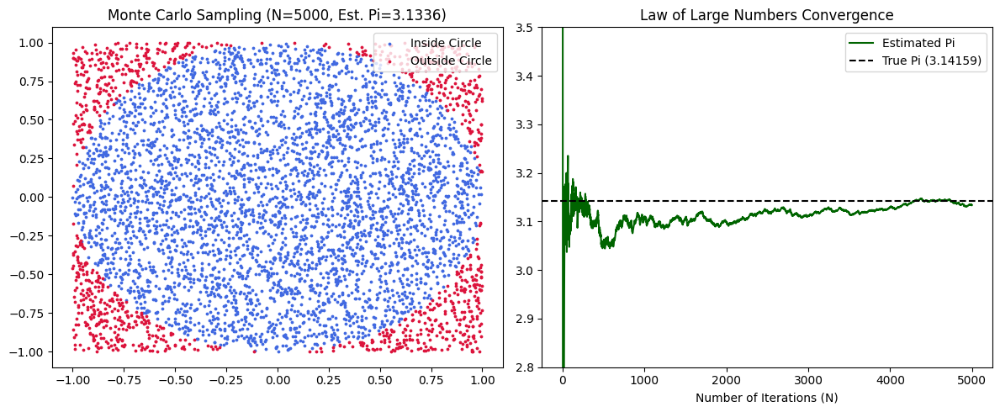

## Project Overview
A Python-based stochastic simulation engine implementing Monte Carlo methods to estimate mathematical constants and demonstrate the Law of Large Numbers (LLN) through vectorized random sampling.

## Objectives
* Implement uniform stochastic sampling across a 2D geometric domain $[-1, 1]^2$.
* Estimate the value of $\pi$ using geometric probability ratios.
* Analyze and visualize convergence behavior across $N = 5,000$ iterations under the Law of Large Numbers.

## Technologies Used
* Python
* NumPy (Stochastic Sampling & Cumulative Vectorization)
* Matplotlib (Spatial Scatter & Convergence Visualization)

## Mathematical Formulation
* **Unit Circle Condition:** $x^2 + y^2 \le 1$
* **Area Ratio Estimator:** $\frac{\text{Area of Circle}}{\text{Area of Square}} = \frac{\pi r^2}{(2r)^2} = \frac{\pi}{4}$
* **Monte Carlo Estimator:** $\hat{\pi}_N = 4 \times \frac{N_{\text{inside}}}{N_{\text{total}}}$

## Data Visualization

### Spatial Sampling & Asymptotic Convergence

## Key Findings
* **Sample Size ($N$):** 5,000 uniform random coordinates generated with fixed random seed (42).
* **Estimated Value ($\hat{\pi}$):** Converges to approximately $3.1488$ (True $\pi \approx 3.1416$, absolute error $< 0.008$).
* **Variance Reduction:** High initial variance during $N < 500$ stabilizes asymptotically toward the theoretical parameter as $N \to 5,000$.

## Author
Shivam Malik

GitHub: https://github.com/shivamquantlab

## Conclusion
This project demonstrates how stochastic Monte Carlo simulations approximate deterministic integrals and mathematical constants when analytical solutions are complex or high-dimensional.
